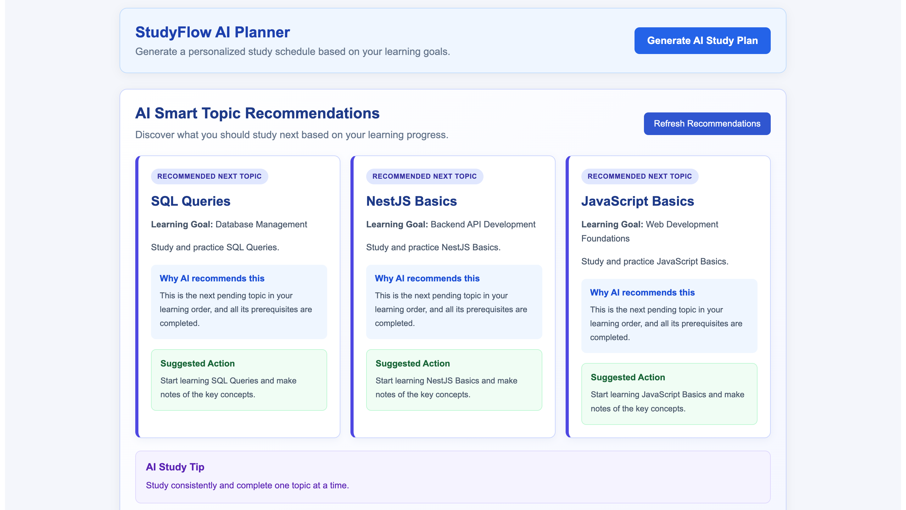
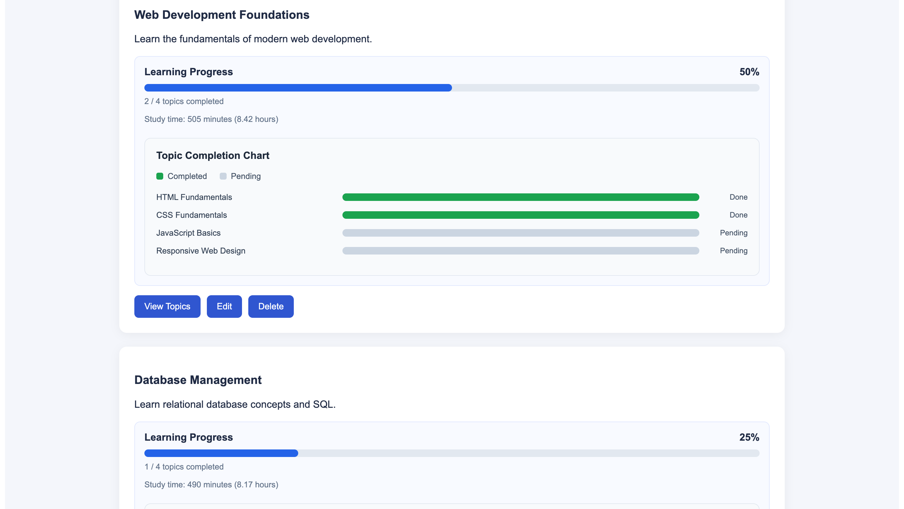
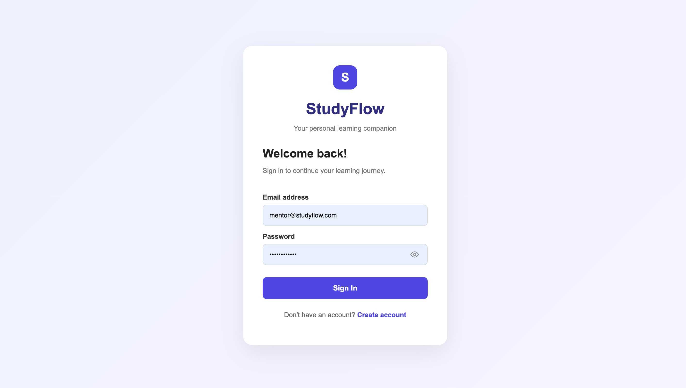
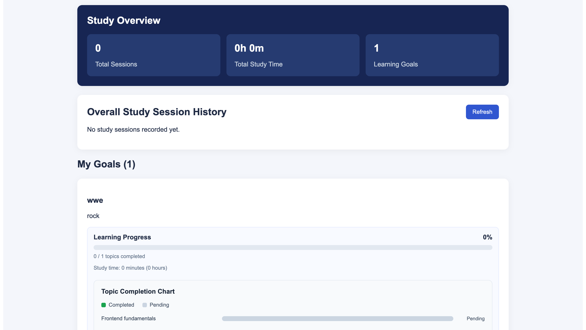
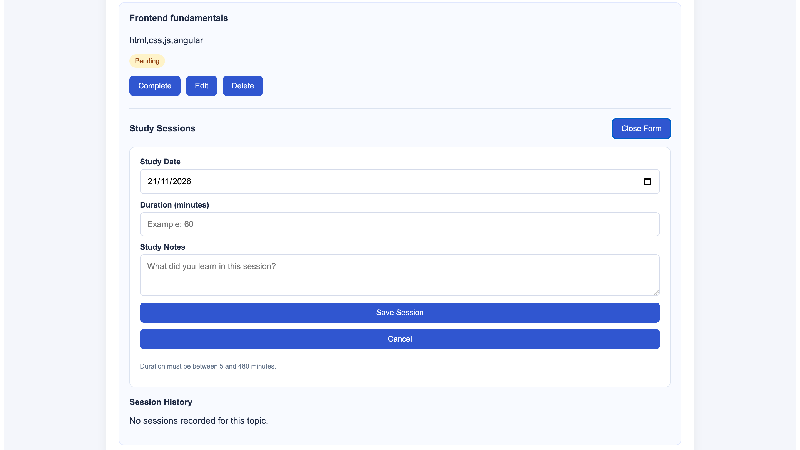

# StudyFlow – AI-Powered Learning Progress Tracker

StudyFlow is a full-stack learning management application that helps learners organize their learning goals, track study sessions, monitor progress, and receive AI-powered study recommendations.

The platform provides separate dashboards for learners and mentors, with secure role-based access control and configurable learning rules.

## Features

### 1. User Authentication and Authorization
- User registration and login.
- Secure password hashing using bcrypt.
- JWT-based authentication.
- Two user roles: Learner and Mentor.
- Server-side role-based access control.
- Protected API endpoints.

### 2. Learning Goal Management
- Create, update, view, and delete learning goals.
- Organize learning goals into individual topics.
- Track completion status for each topic.
- View learning progress for every goal.

### 3. Topic Prerequisites
- Define prerequisite relationships between topics.
- Prevent learners from completing locked topics.
- Automatically identify missing prerequisites.
- Prevent self-referencing prerequisites.
- Prevent circular prerequisite relationships.
- Enforce configurable prerequisite limits.

### 4. Study Session Tracking
- Record study date, duration, and notes.
- View study session history.
- Edit and delete study sessions.
- Validate session duration.
- Prevent future-dated study sessions.
- Prevent session creation for locked topics.

### 5. Learning Progress Dashboard
- View total learning goals.
- Track completed and pending topics.
- Calculate topic completion percentages.
- Monitor total study time.
- View study session history.
- Visualize topic completion using progress charts.

### 6. AI Study Planner
Powered by the Groq API.

- Generate personalized study schedules.
- Set daily available study hours.
- Choose a target completion date.
- Generate daily learning activities.
- Receive personalized AI study tips.
- Organize learning activities around pending topics.

### 7. AI Smart Topic Recommendations
- Recommend the next topic to study.
- Consider prerequisite completion.
- Explain why a topic is recommended.
- Suggest practical next learning activities.
- Refresh recommendations based on learning progress.

### 8. Mentor Dashboard
- View registered learners.
- Monitor learner goals and progress.
- Track completed topics.
- Review total study hours.
- Monitor overall learning performance.

### 9. Mentor Application Settings
Mentors can configure:
- Minimum study session duration.
- Maximum study session duration.
- Maximum prerequisites per topic.

Settings are stored in the database and enforced by backend validation.

## Screenshots

### AI Smart Topic Recommendations


### Learning Progress


### Login Page


### Learning Overview


### Study Sessions


## Technology Stack

| Layer | Technologies |
|---|---|
| Frontend | Angular 20, TypeScript, HTML, CSS |
| Backend | NestJS, TypeScript, Node.js |
| Database | PostgreSQL |
| ORM | TypeORM |
| Authentication | JWT, Passport, bcryptjs |
| AI Integration | Groq API, GPT-OSS-20B |
| Database Hosting | Neon PostgreSQL |

## Project Architecture

```text
StudyFlow/
│
├── frontend/
│   ├── src/
│   │   └── app/
│   │       ├── pages/
│   │       │   ├── login/
│   │       │   ├── register/
│   │       │   ├── dashboard/
│   │       │   ├── mentor-dashboard/
│   │       │   ├── mentor-settings/
│   │       │   └── ai-planner/
│   │       │
│   │       └── services/
│   │
│   └── package.json
│
├── backend/
│   ├── src/
│   │   ├── auth/
│   │   ├── users/
│   │   ├── goals/
│   │   ├── topics/
│   │   ├── sessions/
│   │   ├── progress/
│   │   ├── settings/
│   │   ├── ai/
│   │   └── database/
│   │
│   └── package.json
│
├── .env.local
├── .gitignore
└── README.md
```

## Installation and Setup

### Prerequisites

Install the following before running the project:

- Node.js
- npm
- PostgreSQL database or Neon account
- Git

### 1. Clone the Repository

```bash
git clone YOUR_GITHUB_REPOSITORY_URL
cd study-progress-tracker
```

### 2. Install Frontend Dependencies

```bash
cd frontend
npm install
```

### 3. Install Backend Dependencies

Open another terminal:

```bash
cd backend
npm install
```

### 4. Configure Environment Variables

Create a `.env.local` file in the project root.

Add your own database connection string and secret values:

```env
DATABASE_URL=your_postgresql_connection_string
JWT_SECRET=your_jwt_secret
GROQ_API_KEY=your_groq_api_key
PORT=3000
```

Make sure the variable names match the configuration used by your backend.

**Important:** Never commit `.env.local` or expose database credentials, JWT secrets, or API keys.

### 5. Start the Backend

```bash
cd backend
npm run start:dev
```

Backend API:

```text
http://localhost:3000
```

### 6. Start the Frontend

Open another terminal:

```bash
cd frontend
npm start
```

Frontend application:

```text
http://localhost:4200
```

## Demo Seed Data

The project includes a seed script for creating sample learning data.

It creates:

- 1 dedicated demo learner.
- 3 learning goals.
- 12 topics.
- 9 prerequisite relationships.
- 30 study sessions.

Run the seed script from the backend directory:

```bash
SEED_LEARNER_PASSWORD='YourDemoPassword123' npx ts-node seed.ts
```

Verify the seed data:

```bash
npx ts-node verify-seed.ts
```

Use the password you selected when creating the demo learner.

## Application Routes

| Route | Description |
|---|---|
| `/login` | User login |
| `/register` | User registration |
| `/dashboard` | Learner dashboard |
| `/mentor-dashboard` | Mentor dashboard |
| `/mentor-settings` | Mentor configuration |
| `/ai-planner` | AI study planner |

## Build Commands

### Frontend Production Build

```bash
cd frontend
npx ng build
```

### Backend Production Build

```bash
cd backend
npx nest build
```

Both production builds have been successfully verified during development.

## Security

StudyFlow includes:

- Password hashing.
- JWT authentication.
- Role-based authorization.
- Backend ownership checks.
- Input validation.
- Study session validation.
- Prerequisite enforcement.
- Environment-based secret configuration.

## Future Improvements

- AI-powered weekly learning reviews.
- Advanced learning analytics.
- More detailed progress visualizations.
- Study reminders and notifications.
- Additional learning performance insights.

## Author

**Prakash K.**

Full Stack Developer

Technologies: Angular, TypeScript, NestJS, Node.js, PostgreSQL and AI API Integration.

---

**StudyFlow – Plan Your Learning. Track Your Progress. Achieve Your Goals.**## Database Model

StudyFlow uses PostgreSQL and TypeORM.

Entities:
- User (users): User details, credentials and roles.
- Goal (goals): Learner learning goals.
- Topic (topics): Topics and completion status.
- StudySession (study_sessions): Study dates, duration and notes.
- TopicPrerequisite (topic_prerequisites): Prerequisite relationships.
- AppSetting (app_settings): Configurable application settings using JSONB.

Relationships:
- One User has many Goals.
- One User has many Study Sessions.
- One Goal has many Topics.
- One Topic can have many Study Sessions.
- Topics can depend on other Topics through TopicPrerequisite.

## Automated Tests

StudyFlow includes **27 automated tests** (18 backend unit/integration tests using Jest and 9 frontend tests using Jasmine/Karma) covering authentication, prerequisite cycle detection, session validation, and mentor settings.

Backend test command:
`cd backend && npm test -- --runInBand`

Frontend test command:
`cd frontend && npm test -- --watch=false`

Verified results:
- Backend: 18 tests passed.
- Frontend: 9 tests passed.
- Total: 27 tests passed.

## Database Model

StudyFlow uses PostgreSQL and TypeORM.

Entities:
- User (users): User details, credentials and roles.
- Goal (goals): Learner learning goals.
- Topic (topics): Topics and completion status.
- StudySession (study_sessions): Study dates, duration and notes.
- TopicPrerequisite (topic_prerequisites): Prerequisite relationships.
- AppSetting (app_settings): Configurable application settings using JSONB.

Relationships:
- One User has many Goals.
- One User has many Study Sessions.
- One Goal has many Topics.
- One Topic can have many Study Sessions.
- Topics can depend on other Topics through TopicPrerequisite.
